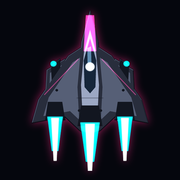

<div align="center">



# SPACEROCKER

**One canyon. Fifteen levels. No continues.**

A vertical electropunk shoot 'em up for the browser — a real 3D world, sprite-sheet
billboards, three composite bosses, and not a single third-party asset.

[](https://www.typescriptlang.org/)
[](https://react.dev/)
[](https://threejs.org/)
[](https://vite.dev/)
[](https://www.python.org/)

</div>

---

## Everything here is generated

No sprite was drawn, no sample was recorded, no texture was downloaded.

| | |
|---|---|
| **Sprites** | a deterministic Python pipeline. Same seed, same bytes, every run. |
| **Soundtrack** | synthesised live with Tone.js, reacting to what is on screen. |
| **Terrain** | seeded noise in a shader — starfield, nebula and canyon walls. |
| **Favicon** | the player ship, rendered through that same pipeline. |

The game ships playable with an empty `public/audio/`. Audio stems are an optional
replacement, never a dependency.

---

## Quick start

```bash
npm install
npm run dev          # http://localhost:5173
```

### Controls

| | |
|---|---|
| **Move** | `WASD` / arrows, or just move the mouse |
| **Fire** | `Space` (hold), left mouse button |
| **Focus mode** | `Shift` — slower, hitbox visible |
| **Bomb** | `X` |
| **Debug overlay** | `F3` — fps, draw calls, pool occupancy |
| **Quit a run** | `Esc` |

Gamepad: left stick, `A` fires, `RT` focuses, `B` drops a bomb. Every keyboard
binding is remappable in Options.

---

## What's in it

- **15 levels across 3 acts** — Dead Orbit, Neon Reef, Core Collapse
- **11 enemies**, each introduced on its own level and never before its telegraph is learnable
- **3 composite bosses** — hull plus independently destructible parts, each with its own HP, hitbox and attack
- **Power-ups** — spread, lance, seeker, aegis, wingman, bombs
- **Energy as fuel**, River Raid style: it drains, and it pushes you forward
- Local scoreboard, saved progress, practice mode, colorblind mode, and `prefers-reduced-motion` support

---

## Scripts

| Command | What it does |
|---|---|
| `npm run dev` | development server |
| `npm run build` | production build |
| `npm test` | Vitest — collision, RNG, bosses, level data |
| `npm run lint` | Biome |
| `npm run sprites` | regenerate the atlases *(needs Python)* |
| `npm run icons` | regenerate the favicon from the player ship *(needs Python)* |
| `npm run playtest` | play all 15 levels with a bot and report the balance |

`npm run playtest -- --run` plays the whole campaign, carrying weapons between
levels; `npm run playtest -- 10` plays just one. It drives the real simulation
with no renderer, so 15 levels take seconds — this is the test that answers *"is
this playable?"* instead of *"does this compile?"*.

---

## Regenerating sprites

Needs Python 3.12 with Pillow and numpy:

```bash
pip install pillow numpy
python -m spritegen.build --act 1    # act1 + BOSS 1 + player/pickups
python -m spritegen.build --act 2    # act2 + BOSS 2
python -m spritegen.build --act 3    # act3 + BOSS 3
```

Output lands in `public/sprites/`. Running it twice produces byte-identical
files — the RNG is seeded per entity. `sprites-preview.html` is the review
screen: it plays every animation at the real in-game fps and includes the 60px
silhouette test.

Flags: `--skip-boss`, `--skip-common`, `--only-common`, `--only-icons`.

The favicon comes from the same place: `--only-icons` renders the player ship,
frames it on the void, and writes `favicon.ico` (16/32/48/64), `favicon-32.png`
and `apple-touch-icon.png` into `public/` — the web root, not next to the atlases.

| To change | Edit |
|---|---|
| An enemy's shape | `spritegen/enemies.py` |
| A boss | `spritegen/{hexapod,basilisk,ouroboros}.py` |
| Tone ramps, bevel, explosions | `spritegen/render.py` |
| Animation curves, damage, flash | `spritegen/anim.py` |
| Packing, padding, JSON | `spritegen/atlas.py` |

---

## How it fits together

```
Loop:  requestAnimationFrame
       ├─ fixed 1/60s step   (input, AI, movement, collision, spawning)
       └─ interpolated render (alpha between the previous and current state)
```

`src/game/Simulation.ts` is the entire game in plain TypeScript: no React, no
three.js. Everything the renderer needs is readable state on that object;
everything the simulation needs arrives through `input`. That separation is what
guarantees React **never** re-renders during play — the HUD draws once and is
then written straight to the DOM, frame by frame.

```
src/
  game/
    Simulation.ts      the game (fixed step, no React/three)
    Engine.tsx         R3F canvas + loop + F3 overlay
    core/              rng, pools, spatial hash, atlas, constants
    systems/           system order, projectiles, particles, input
    ai/                the 11 bestiary behaviours
    bosses/            shared FSM + hexapod / basilisk / ouroboros
    render/            instanced billboards, terrain, post-processing
    world/             the canyon (a 1D function)
    audio/             MusicDirector (Tone) + SfxEngine (raw Web Audio)
  data/
    levels/level-01..15.ts   levels are data, not code
    enemies.ts weapons.ts
  ui/                  screens and HUD
spritegen/             sprite generator (Python)
```

### Four things worth knowing before you touch it

**The canyon is a 1D function, not a heightfield.** `world/canyon.ts` returns the
corridor's width and centre for a given distance travelled. The wall mesh and the
collision test call the **same** function — what kills you is exactly what you
see. Touching a wall is fatal; that is the River Raid DNA. The walls are two
structures suspended over the void, and the backdrop is a shader-generated
starfield and nebula scrolling in three parallax layers.

**Nobody fires from off-screen.** Enemies spawn well beyond the visible edge so
they can fly in, but their weapon clock only runs inside
`ENGAGE_Z_MIN..ENGAGE_Z_MAX`. Freezing the clock — rather than just blocking the
shot — is what guarantees a ship enters *and* still plays its telegraph before
firing.

**Bosses are composite.** A hull plus independently destructible parts, each with
its own HP, hitbox and sprite, assembled at the `anchor` points published in the
atlas JSON. Destroying a part removes its attack. Part names live in the Python
and the TypeScript at once — `tests/boss-atlases.test.ts` exists to stop the two
drifting apart in silence.

**The reading rule is non-negotiable.** Enemy fire is always orange `#FF6B1A`,
player fire always cyan `#00E5FF`. Every dangerous attack charges for at least
0.4s before it leaves. If a visual effect makes a projectile harder to read, the
effect goes.

---

## Status

Playable start to finish: 15 levels, 11 enemies, 3 bosses, power-ups, a local
scoreboard, saved progress, remappable controls, practice mode, colorblind mode
and reduced-motion support.

`DECISIONS.md` records where the spec was ambiguous and what was chosen —
including the known gaps (audio has not been validated with a live sound context;
60 fps has not been measured on a real GPU, only on software GL). `IDEAS.md`
keeps what was deliberately left out of scope.
